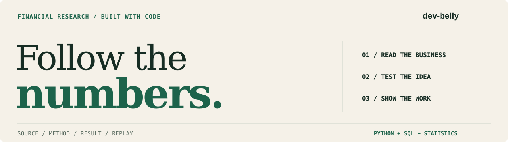
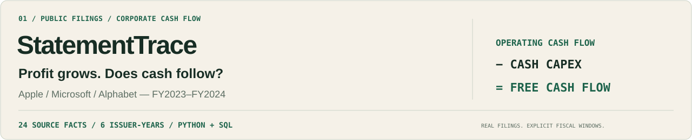
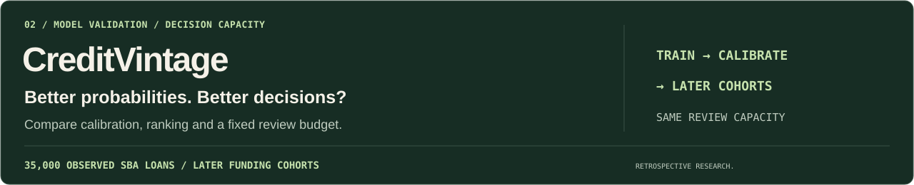
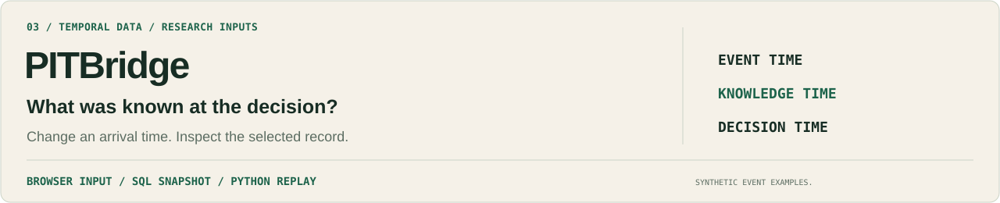

  
    
  <a href="https://dev-belly.github.io/StressAtlas/curveshift/hedge/"><b>GIVE THE HEDGE A BUDGET</b></a> &nbsp; / &nbsp;
  <a href="FOR_RECRUITERS.md"><b>FOR RECRUITERS · 招聘速览</b></a> &nbsp; / &nbsp;
  <a href="CATALOG.md"><b>PROJECT INDEX</b></a>

 

I'm **dev-belly**, studying **Data Science & Big Data Technology at Central University of Finance and Economics (CUFE), Class of 2029**.
I use **Python, SQL and statistics** to turn financial questions into research someone else can inspect and rerun.

中央财经大学数据科学本科在读，关注**金融数据分析、企业研究与量化研究方法**。
希望把数据整理、统计分析和研究实现能力用在券商、基金与研究团队的实习中。

## New research · a hedge with a budget

**What should you trade after finding the risk?** [CurveShift's constrained hedge laboratory](https://dev-belly.github.io/StressAtlas/curveshift/hedge/)
keeps a hypothetical $10m 7Y bond and optimizes four hedge maturities under gross
face limits, per-bond caps and entry cost. A sparse **513-variable CVaR program**
uses 504 changes through 2024; 249 changes in 2025 evaluate the fixed trades.
At $6m hedge face, held-out scenario ES falls **$71,789 → $29,040**, before a
**$1,200** entry cost. Change the budget, inspect residual DV01, stress the actual
cash flows and download the trades. This is a fixed-cash-flow scenario study.

**SciPy sparse · HiGHS · QuantLib · FastAPI.** [中文推导与面试说明](https://github.com/dev-belly/StressAtlas/blob/main/labs/curveshift/docs/HEDGING.zh-CN.md) ·
[Optimizer](https://github.com/dev-belly/StressAtlas/blob/main/labs/curveshift/src/curveshift/hedge.py) ·
[Saved decisions and losses](https://github.com/dev-belly/StressAtlas/tree/main/labs/curveshift/reports/hedge).

**Can a DV01-neutral portfolio still lose money when rates move?** [CurveShift](https://dev-belly.github.io/StressAtlas/curveshift/) matches a hypothetical long 10Y bond with a short 2Y bond. Parallel DV01 is approximately zero, yet a 2Y −25bp / 10Y +25bp twist loses **$93,918.70**. Move four curve points, inspect the repriced cash flows, then download your scenario and replay it in Python.

**QuantLib · Nelson–Siegel–Svensson · Polars · scikit-learn · FastAPI · uv.** The research uses 2,499 historical Treasury curve estimates; the bonds are hypothetical. NSS uses luphord's credited MIT library. [中文简报](https://github.com/dev-belly/StressAtlas/blob/main/labs/curveshift/docs/RESEARCH.zh-CN.md) · [Source and method](https://github.com/dev-belly/StressAtlas/blob/main/labs/curveshift/docs/METHOD.md) · [Install the application](START_HERE.md#curveshift-bend-the-curve-then-replay-your-scenario).

## Selected work

Three projects, three questions: **understand the business → evaluate a model → reconstruct the data behind a decision**.

**Why can profit rise much faster than free cash flow?** A historical FY2023–FY2024 study compares three issuers using 24 curated SEC filing facts. Alphabet's profit grew **35.67%**, while FCF grew **4.70%**; the report reconciles the operating cash-flow increase with higher cash capex.

[Read the report](https://dev-belly.github.io/StatementTrace/cashflow/) · [中文研究简报](https://github.com/dev-belly/StatementTrace/blob/main/docs/CASHFLOW_STUDY.zh-CN.md) · [24 source facts](https://github.com/dev-belly/StatementTrace/blob/main/examples/cashflow/source_facts.csv) · [SQL](https://github.com/dev-belly/StatementTrace/blob/main/src/statementtrace/data/cashflow_compare.sql)

Historical case, filed-date cutoff 2025-02-05. Different fiscal windows; Apple's FY2023 has 53 weeks. Compare each issuer with its own prior year. FCF is CFO minus cash capex.

**Does a better probability estimate make a better review queue?** On **35,000 observed SBA loans**, separate training, calibration and later funding cohorts expose a tradeoff: calibration can improve probability error while weakening ranking and event capture at the same review capacity. Saved predictions support independent SQL analysis.

[Compare review budgets](https://dev-belly.github.io/CreditVintage/sba-brief/) · [Study and assumptions](https://github.com/dev-belly/CreditVintage/blob/main/docs/SBA_CREDIT.md) · [SQL exercise](https://github.com/dev-belly/CreditVintage/blob/main/docs/SBA_REVIEW_SQL.md)

Retrospective funding-cohort research with mature outcome windows. The final source snapshot lacks historical publication and revision records.

**Was that information available when the decision was made?** Change one invoice's arrival time in the browser, inspect the selected record, then download the scenario and replay it in Python. The implementation separates event time from knowledge time and checks SQL against a separate Python path.

[Try one timestamp](https://dev-belly.github.io/PITBridge/try/) · [Replay the scenario](START_HERE.md#download-and-replay-your-browser-scenario) · [Implementation](https://github.com/dev-belly/PITBridge/blob/main/src/pitbridge/core.py)

Small synthetic invoice/event examples make the temporal rules visible.

## Research bench

| Project | What to inspect | Current evidence |
| :--- | :--- | :--- |
| [AlphaForge](https://github.com/dev-belly/alphaforge) | Factor evaluation, walk-forward splits, portfolio constraints and costs | [Small evaluation counterexample](INTERVIEW_PLAYBOOK.zh-CN.md#共同样本与分组口径). Archived backtests await refitting under the corrected trading-session split protocol. |
| [TradeForge](https://github.com/dev-belly/TradeForge) | C++20 order-book logic and Python execution analysis | [Public-market case](https://github.com/dev-belly/TradeForge/blob/main/docs/PUBLIC_MARKET_CASE.md). Public depth supports hypothetical execution, not observed fills. |
| [StressAtlas / CurveShift](https://github.com/dev-belly/StressAtlas/tree/main/labs/curveshift) | Curve-shape risk, constrained CVaR hedging, full revaluation and chronological evaluation | [Hedge laboratory](https://dev-belly.github.io/StressAtlas/curveshift/hedge/): observed staff curve estimates and hypothetical bonds. The separate [credit study](https://dev-belly.github.io/StressAtlas/) uses synthetic portfolios. |

**Financial data pipeline:** [Polars → Parquet → DuckDB → dbt](https://github.com/dev-belly/StatementTrace/blob/main/docs/WAREHOUSE.zh-CN.md).
The filing study now has a typed columnar route, SQL window calculations and a
three-model dbt project with 21 data tests. Direct SQL and dbt each check 138
fields against Python; tests retain missing filings and exact integer amounts.
[Pipeline](https://github.com/dev-belly/StatementTrace/blob/main/src/statementtrace/warehouse.py) ·
[dbt models](https://github.com/dev-belly/StatementTrace/tree/main/warehouse_dbt/models) ·
[Locked cross-platform checks](https://github.com/dev-belly/StatementTrace/blob/main/.github/workflows/warehouse.yml).
The demonstration uses the same 24 curated facts; scale and production performance are unmeasured.

**Typed research API:** [FastAPI + Pydantic + Uvicorn](https://github.com/dev-belly/StatementTrace/blob/main/docs/API.zh-CN.md).
Query cash flow and selected filing facts by issuer and fiscal year, with bounded
pagination and one verified snapshot identity. Exact monetary strings survive
JSON without floating-point loss; unsupported cutoff overrides are rejected.
Six read-only data routes, OpenAPI/Swagger documentation and real HTTP checks
also run from an installed wheel outside the checkout.
[Application factory](https://github.com/dev-belly/StatementTrace/blob/main/src/statementtrace/api.py) ·
[Request examples](https://github.com/dev-belly/StatementTrace/blob/main/examples/api/requests.http).
The API runs locally; GitHub Pages hosts the static study.

## Explore further

[All 19 projects and their data scope](CATALOG.md) · [Run a project](START_HERE.md) · [Project briefs](PROJECT_BRIEFS.md) · [Current priorities](OPEN_SOURCE_ROADMAP.zh-CN.md)

Implementation history and review notes

[Validation archive](PROJECT_REVIEW.md) · [Changelog](CHANGELOG.md) · [Interview workbook](INTERVIEW_PLAYBOOK.zh-CN.md) · [Contribution guide](CONTRIBUTING.md)

