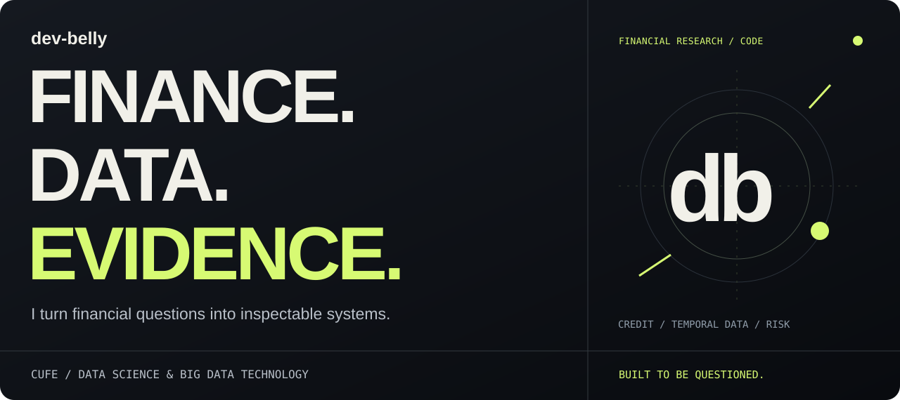
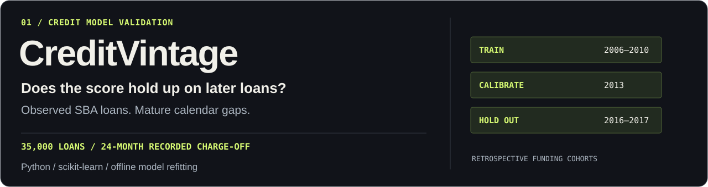
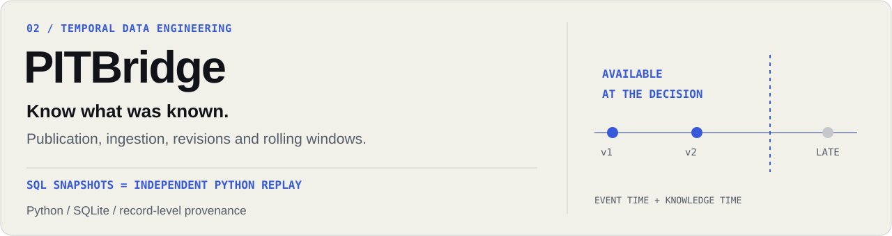
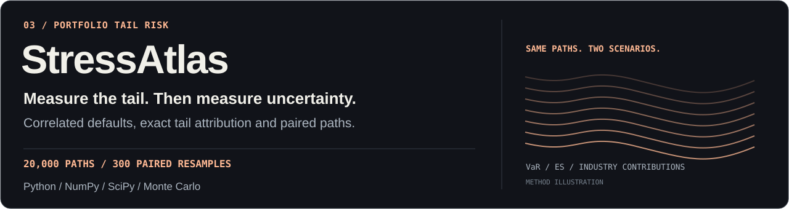

  
    
   &nbsp; / &nbsp;
  <a href="https://dev-belly.github.io/CreditVintage/analysis/"><b>LIVE DEMO</b></a> &nbsp; / &nbsp;
  <a href="PROJECT_BRIEFS.md"><b>RESULTS &amp; CODE</b></a> &nbsp; / &nbsp;
  <a href="#research-in-public"><b>RECENT WORK</b></a>

 

I'm **dev-belly**, a **Data Science & Big Data Technology** student at **Central University of Finance and Economics**. I build tools for credit risk, financial data analysis and quantitative research.

把金融问题拆成能运行、能检验、能追溯的系统：从 SQL 客群分析和人工复核，到决策时点的数据、财报指标与组合风险。

**New here?** [Change one invoice timestamp in your browser](START_HERE.md#try-in-your-browser), [install a project from an empty directory](START_HERE.md#try-a-project), or [review a business decision and its code](START_HERE.md#review-the-work). 新访客可先在浏览器核对三次固定决策，再改一个时间；招聘与面试审阅可沿业务问题、结果和代码查看。

## Start with a business question

| Question | Open the result | Follow the code |
| :--- | :--- | :--- |
| How do credit models compare at the same review capacity? | [30,000 card accounts](https://dev-belly.github.io/CreditVintage/card-credit/) | [Training and refitting](https://github.com/dev-belly/CreditVintage/blob/main/src/creditvintage/card_credit.py) · [Protocol](https://github.com/dev-belly/CreditVintage/blob/main/docs/CARD_CREDIT.md) |
| Which credit cohorts need attention? | [SQL credit analysis](https://dev-belly.github.io/CreditVintage/analysis/) | [Cohort SQL](https://github.com/dev-belly/CreditVintage/blob/main/src/creditvintage/business_groups.sql) · [Review workflow](https://github.com/dev-belly/CreditVintage/blob/main/docs/REVIEW_WORKFLOW.md) |
| What could a decision know before a late correction arrived? | [Run three decisions in your browser](https://colab.research.google.com/github/dev-belly/PITBridge/blob/main/examples/decision_time.ipynb) | [Three-decision example](https://github.com/dev-belly/PITBridge/blob/main/examples/README.md) |
| How does clustered default change portfolio losses? | [Stress report](https://dev-belly.github.io/StressAtlas/) | [Tail math and uncertainty](https://github.com/dev-belly/StressAtlas/blob/main/docs/METHODOLOGY.md) |

**A useful result includes its limits.** CreditVintage compares four fixed methods on [30,000 observed card records](https://dev-belly.github.io/CreditVintage/card-credit/), retaining five train/calibration/test splits and every model result. The separate German-credit experiment retains its negative calibration result. Native targets and random splits are kept distinct from the synthetic timed-event experiment. [Project evidence](PROJECT_BRIEFS.md) connects each claim to its inputs, implementation and validation.

## Flagship projects

**01 · CreditVintage — Credit analysis that reaches a review decision.**

训练、校准、测试分期隔离；标签等待完整表现期。SQL 按放款月份和客群对照风险事件与预测偏差；固定容量清单不含未来标签。SQLite 复核工作区记录认领、结案、理由和材料引用，并处理并发版本冲突与重复请求。

公开信用卡实验覆盖 30,000 条 UCI 记录、五次固定划分和四种方法，保留 12 万个模型分数、三档相同复核预算及无标签队列；全部来源、分数和下载包均可重新拟合核验。历史单一客群的随机切分与上面的合成时序验证分开解释，原德国信贷实验继续保留。

新增可编辑 CSV 输入样例与训练前诊断：按文件、行号定位多处错误，检查重复修订、决策时可用特征与成熟标签；诊断过程不修改输入、不训练模型。

[Source](https://github.com/dev-belly/CreditVintage) · [30,000-account comparison](https://dev-belly.github.io/CreditVintage/card-credit/) · [Checked release](https://github.com/dev-belly/CreditVintage/releases/tag/v0.3.0) · [SQL analysis](https://dev-belly.github.io/CreditVintage/analysis/) · [Lineage](https://dev-belly.github.io/CreditVintage/lineage/) · [CSV inputs and diagnostics](https://github.com/dev-belly/CreditVintage/blob/main/docs/CUSTOM_INPUTS.md)

 

**02 · PITBridge — Reconstruct what a decision could actually know.**

同时考虑事件、发布、入库时间与历史修订；构造决策时点快照和 7/30 天滚动特征。每个聚合值保留源记录成员，SQLite 结果与独立 Python 实现逐项核对。先试一张发票，再接 CSV 或可选的 pandas。

[Source](https://github.com/dev-belly/PITBridge) · [Run in browser](https://colab.research.google.com/github/dev-belly/PITBridge/blob/main/examples/decision_time.ipynb) · [Invoice / CSV example](https://github.com/dev-belly/PITBridge/blob/main/examples/README.md) · [Snapshot report](https://dev-belly.github.io/PITBridge/) · [Rolling features](https://dev-belly.github.io/PITBridge/rolling/)

 

**03 · StressAtlas — A tail estimate should come with its uncertainty.**

用借款人层面的相关违约路径比较基准与压力情景；计算离散尾部 ES 和行业贡献，再用成对重采样检查估计精度。相同借款人的多笔贷款共享一次违约事件；不把平均损失的标准误当作 VaR 的置信区间。

[Source](https://github.com/dev-belly/StressAtlas) · [Stress report](https://dev-belly.github.io/StressAtlas/) · [Tail precision](https://dev-belly.github.io/StressAtlas/precision/) · [Method](https://github.com/dev-belly/StressAtlas/blob/main/docs/METHODOLOGY.md)

Examples identify their public-filing, public static-credit or synthetic inputs. Static and synthetic experiments do not establish future borrower risk or live investment performance.

## More financial systems

<b>Explore financial statements, execution, accounting and audit tools</b>

 

| Project | What to inspect | Result / walkthrough |
| :--- | :--- | :--- |
| [StatementTrace](https://github.com/dev-belly/StatementTrace) | Public filings → availability cutoff → exact fiscal periods → financial metrics | [Live report](https://dev-belly.github.io/StatementTrace/) · [SEC source ledger](https://github.com/dev-belly/StatementTrace/blob/main/docs/SOURCES.md) |
| [NetworkClear](https://github.com/dev-belly/NetworkClear) | Counterparty shocks, exact debt clearing and outside-loss reconciliation | [Live report](https://dev-belly.github.io/NetworkClear/) · [Clearing method](https://github.com/dev-belly/NetworkClear/blob/main/docs/METHODOLOGY.md) |
| [AlphaForge](https://github.com/dev-belly/alphaforge) | Factor signals, walk-forward validation, portfolio constraints and costs | [Real-price comparison](https://github.com/dev-belly/alphaforge/blob/main/docs/research-comparison.md) · [Synthetic sample run](https://dev-belly.github.io/alphaforge/sample-run/) |
| [TradeForge](https://github.com/dev-belly/TradeForge) | C++ execution events checked against an independent Python reference | [Public-quote matching case](https://github.com/dev-belly/TradeForge/blob/main/docs/PUBLIC_MARKET_CASE.md) · [Synthetic demo](https://github.com/dev-belly/TradeForge#sixty-second-tour) |
| [ControlTrace](https://github.com/dev-belly/ControlTrace) | Audit conclusions tied to the current evidence version | [Case study](https://github.com/dev-belly/ControlTrace/blob/main/docs/CASE_STUDY.md) |
| [AuditLens](https://github.com/dev-belly/AuditLens) | Anomaly detection → an explainable review item | [Workpapers](https://github.com/dev-belly/AuditLens/tree/main/outputs/reports) |
| [LedgerX](https://github.com/dev-belly/LedgerX) | Trading fills, accounting entries and valuation reconciled exactly | [Valuation example](https://github.com/dev-belly/LedgerX/blob/main/examples/valuation.json) |

**Know the data boundary:** StatementTrace uses curated public-filing excerpts; AlphaForge's separate comparison uses historical mirrored equity prices but incomplete membership/publication histories; TradeForge's public depth capture powers hypothetical fills. CreditVintage's dated-event demonstrations, StressAtlas and NetworkClear remain synthetic. Its UCI card and German experiments retain their distinct native targets; random customer splits do not establish future-period performance. [Read the matching assumptions](https://github.com/dev-belly/TradeForge/blob/main/docs/PUBLIC_MARKET_CASE.md) before quoting a market cost.

## Research in public

<b>Inspect recent changes and their validation</b>

 

Recent changes connect the demonstrations to concrete operational checks:

- **Observed data, explicitly bounded:** [AlphaForge #4](https://github.com/dev-belly/alphaforge/pull/4) retains all 22 historical-price comparison cases and independently rechecks reported returns; [TradeForge #14](https://github.com/dev-belly/TradeForge/pull/14) replays public quote packets offline into 18 hypothetical matching/fee/latency scenarios. Neither proves a tradable edge or actual order fills.

- **Installed packages:** [CreditVintage #12](https://github.com/dev-belly/CreditVintage/pull/12) and [PITBridge #13](https://github.com/dev-belly/PITBridge/pull/13) replay built wheels in clean environments outside their source trees on Linux and Windows.
- **Credit review:** [CreditVintage #11](https://github.com/dev-belly/CreditVintage/pull/11) adds ownership, recorded reasons and retry protection; [#14](https://github.com/dev-belly/CreditVintage/pull/14) delivers evidence that replays without the database.
- **Failure paths:** [LedgerX #4](https://github.com/dev-belly/LedgerX/pull/4) stages whole retriable batches; [AuditLens #5](https://github.com/dev-belly/AuditLens/pull/5) refuses conflicting master records; [WeCom #3](https://github.com/dev-belly/wecom-agent-platform/pull/3) keeps queries on one index generation.
- **Evidence and report access:** [ControlTrace #5](https://github.com/dev-belly/ControlTrace/pull/5) binds conclusions to evidence versions; [TradeForge #13](https://github.com/dev-belly/TradeForge/pull/13) confines report requests to the configured directory.

[Build history](CHANGELOG.md) · [Validation evidence and exact commits](PROJECT_REVIEW.md) · [Business walkthrough and interview practice](INTERVIEW_PLAYBOOK.zh-CN.md)

准备面试可先用 [60 秒讲解与五个追问](面试速讲卡.zh-CN.md)，再沿实际操作、失败场景和代码展开。

<b>Experiments & earlier work</b>

 

| Experiment | What it explores |
| :--- | :--- |
| [Investor Network GNN](https://github.com/dev-belly/investor-network-gnn) | Graph ablations and [three-seed saved predictions](https://github.com/dev-belly/investor-network-gnn/tree/main/experiments/2026-09-17). |
| [High-dimensional Causal Allocation Lab](https://github.com/dev-belly/highdim-causal-allocation-lab) | Simulated causal estimation and robust allocation; [interactive example](https://dev-belly.github.io/highdim-causal-allocation-lab/). |
| [Interval Financial Risk](https://github.com/dev-belly/interval-financial-risk) | A [retained negative result](https://dev-belly.github.io/interval-financial-risk/): distributional features reduced AUC in this synthetic experiment. |
| [FactorLab](https://github.com/dev-belly/ashare-multifactor-research) | A-share factor evaluation and purged validation; [中文文档](https://github.com/dev-belly/ashare-multifactor-research/blob/main/README.zh-CN.md). |
| [WeCom Agent Platform](https://github.com/dev-belly/wecom-agent-platform) | Contract filtering and currency-aware holding totals; [offline business trial](https://github.com/dev-belly/wecom-agent-platform/blob/main/docs/business-workflow.md). |
| [Personal AI Chat](https://github.com/dev-belly/personal-ai-chat) | Local chat plus a separately configured private model connection. |

Earlier builds: [Digital Craftsman](https://github.com/dev-belly/digital-craftsman) · [Ranxin](https://github.com/dev-belly/ranxin-mini-program) · [Goose Leg Auntie](https://github.com/dev-belly/goose-leg-auntie-site).

---

[Start here](START_HERE.md) · [Project evidence](PROJECT_BRIEFS.md) · [Business walkthrough](INTERVIEW_PLAYBOOK.zh-CN.md) · [Open-source roadmap](OPEN_SOURCE_ROADMAP.zh-CN.md) · [Portfolio review](PROJECT_REVIEW.md) · [Project adoption](PROJECT_ADOPTION.zh-CN.md) · [Design references](PROFILE_REFERENCES.md) · [Profile CI](https://github.com/dev-belly/dev-belly/actions/workflows/ci.yml)

Financial questions. Runnable code. Evidence you can inspect.
